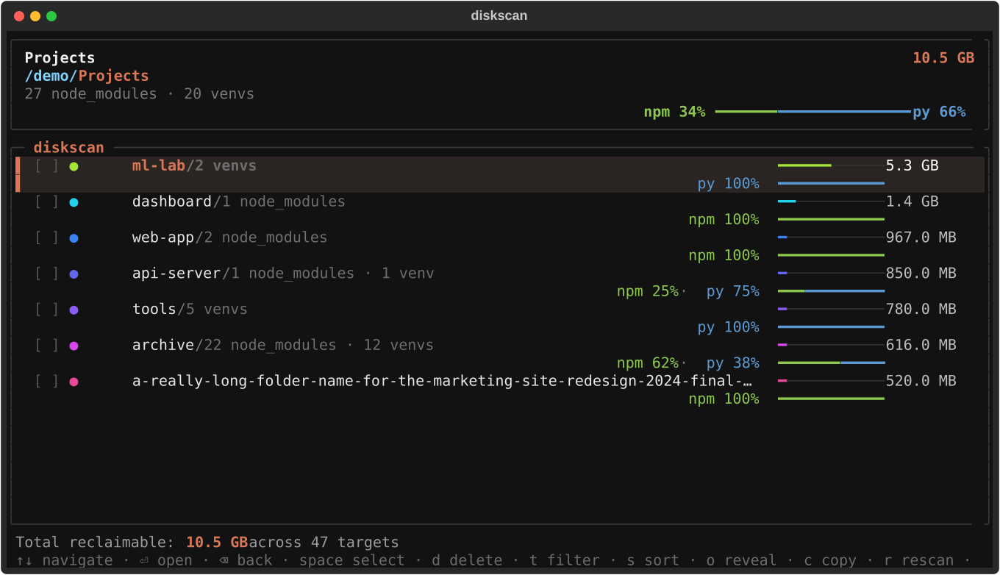
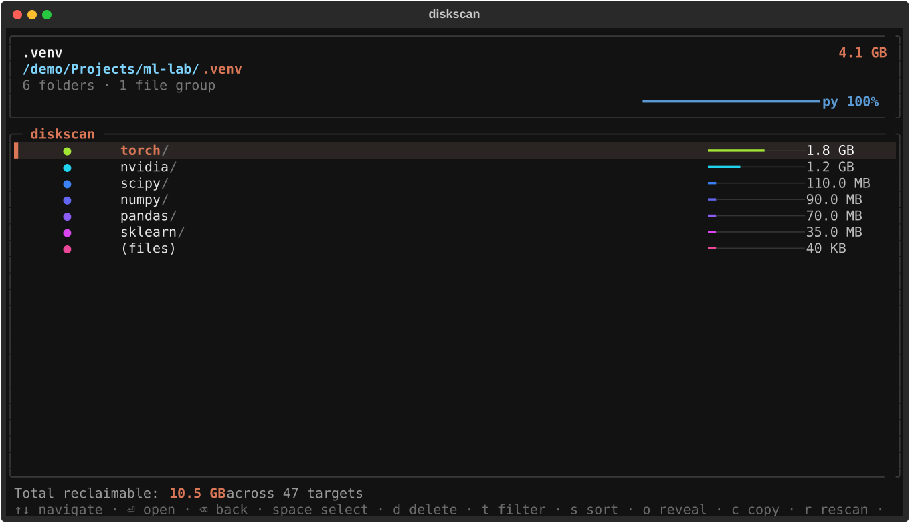
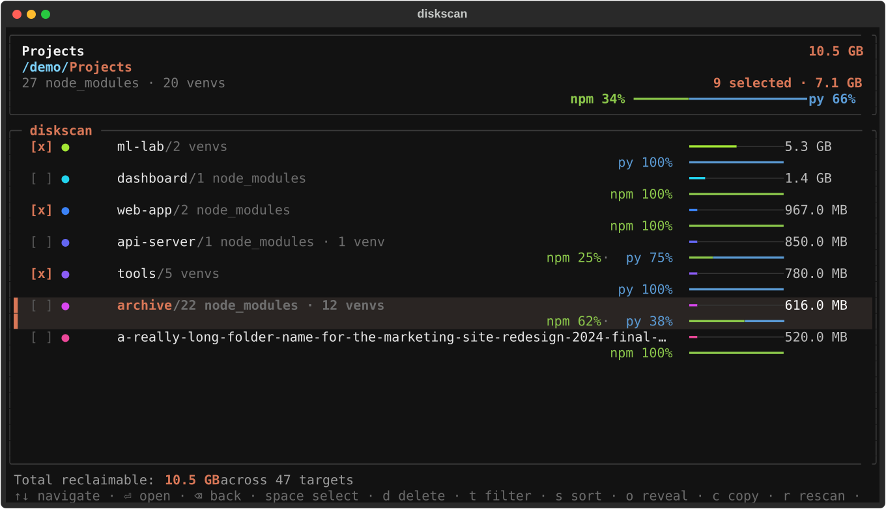
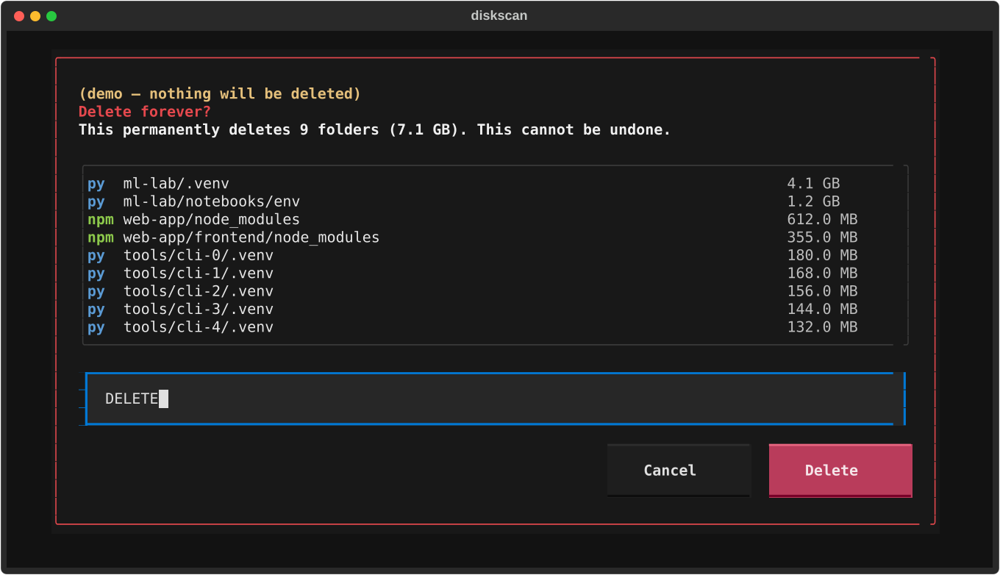
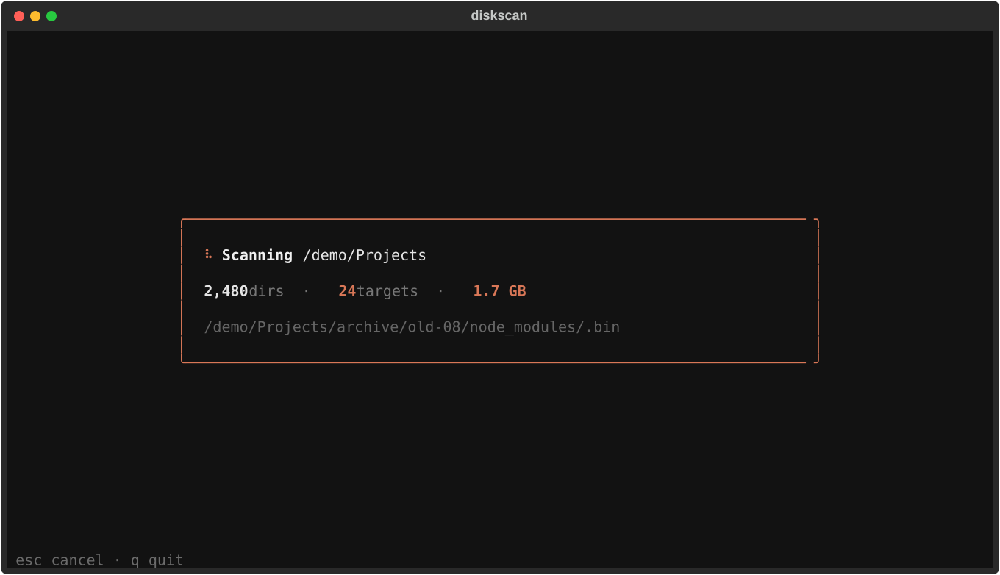

<div align="center">

# diskscan

**Find every `node_modules` and Python virtualenv on your disk, see what they cost you, and clean them up.**

[](CHANGELOG.md)
[](https://www.python.org)
[](#install)
[](https://textual.textualize.io)
[](LICENSE)
[](https://semver.org)



[Install](#install) · [Usage](#usage) · [Keys](#keys) · [How it works](#how-it-works) · [Updating](#updating) · [Changelog](CHANGELOG.md) · [License](#license)

</div>

---

## Why

Every JavaScript project carries a `node_modules`. Every Python project carries a virtualenv, and they're called
`.venv`, `venv`, `env`, `.tox/py312` or whatever someone typed that day. A few hundred projects later they add up to
tens or hundreds of gigabytes, and your file browser won't tell you where.

diskscan walks a folder, finds them all by what they *are* rather than what they're named, and shows them in a fast
terminal UI so you can decide what to delete.

## Features

- 🔍 **Finds venvs by their contents, not their names**: `pyvenv.cfg` (venv, virtualenv, uv, poetry, pdm, tox, nox), `conda-meta/` (conda/mamba), with a `bin/python` + `site-packages` fallback.
- 📦 **`node_modules`, counted once**: nested `node_modules` are part of their parent's total, never double counted.
- 📏 **Real on-disk sizes**: block based, symlinks never followed, hard links shared by the uv cache or pnpm store counted once. The numbers match `du`.
- 🌳 **Drill-down browser**: open any folder, then open a venv or `node_modules` to see which packages are heaviest.
- 📊 **npm vs py split**: see at a glance how much of each folder is JavaScript vs Python.
- ☑️ **Select and delete**: tick folders with `space`, delete with `d`, confirm by typing `DELETE`. Every path is re-checked right before it's removed.
- ⚡ **Fast**: only walks until it finds a target, then sizes targets in parallel. Live progress; `esc` stops early and shows what it found.
- 🔄 **Self-updating**: `diskscan update`, plus a quiet once-a-day "update available" notice.

## Install

```sh
curl -fsSL https://raw.githubusercontent.com/guillemgonzalez/diskscan/main/install.sh | sh
```

The installer sets up [uv](https://docs.astral.sh/uv/) if you don't have it, then installs diskscan as an isolated
tool. uv fetches its own Python, so nothing else is needed. Works on **macOS** and **Linux**.

It installs from PyPI when a release is published there, and otherwise straight from this GitHub repo.

<details>
<summary><b>Other ways to install</b></summary>

<br>

With uv or pipx, once published on PyPI (the package is `diskscan-tui`; the command is `diskscan`):

```sh
uv tool install diskscan-tui
pipx install diskscan-tui
```

Straight from GitHub, without PyPI:

```sh
uv tool install git+https://github.com/guillemgonzalez/diskscan
```

Installer options (environment variables):

| Variable | Effect |
| --- | --- |
| `DISKSCAN_SOURCE` | Install from somewhere other than PyPI: a git URL (`git+https://github.com/guillemgonzalez/diskscan`), a tag (`git+https://github.com/guillemgonzalez/diskscan@v0.1.0`) or a local checkout path. |
| `DISKSCAN_NO_MODIFY_PATH=1` | Don't edit shell profiles to add the tool folder to `PATH`. |

</details>

## Usage

```sh
diskscan ~/Projects     # scan a folder (default: the current directory)
diskscan --demo         # try it on made-up data; nothing is scanned or deleted
diskscan --version
diskscan update         # upgrade to the latest version
```

### Open a venv or `node_modules` to see what's inside



### Select what to clean up

Tick rows with `space`. Ticking a project folder ticks every venv and `node_modules` inside it; `[-]` means partly ticked.
The header shows how many are selected and how much space that is.



### Delete, with a typed confirmation

`d` opens a confirmation listing every folder and the total. Nothing happens until you type exactly `DELETE`, every time.



> [!WARNING]
> Deletion is **permanent**: folders are removed, not moved to the Trash, so the space is freed straight away.
> Everything diskscan deletes can be rebuilt with `npm install`, `uv sync` or `pip install -r requirements.txt`.

<details>
<summary><b>Scanning in progress</b></summary>

<br>



</details>

## Keys

| Key | Action |
| --- | --- |
| `↑` `↓` / `j` `k` | Move |
| `⏎` `→` / `l` | Open folder (or expand "smaller objects…") |
| `⌫` `←` / `h` | Go back up |
| `pgup` `pgdn` / `g` `G` | Page / jump to top or bottom |
| `space` | Tick / untick row and move down |
| `a` | Tick everything in the current view |
| `A` / `u` | Clear the selection |
| `d` / `delete` | Delete ticked folders (type `DELETE` to confirm) |
| `t` | Filter: all / node_modules only / venvs only |
| `s` | Sort by size / name |
| `o` | Reveal in Finder (macOS) or your file manager (Linux) |
| `c` | Copy path |
| `r` | Rescan |
| `esc` | Stop a running scan |
| `?` | Help |
| `q` / `ctrl+c` | Quit |

## How it works

| What | How it's detected |
| --- | --- |
| `node_modules` | A folder named `node_modules`. Only the top-most one is reported; nested ones are included in its size. |
| venv / virtualenv / uv / poetry / pdm / tox / nox | A `pyvenv.cfg` file in the folder. The label (e.g. `uv venv · py 3.13`) comes from that file. |
| conda / mamba | A `conda-meta/` folder. |
| Anything else Python-shaped | `bin/python*` (or `Scripts/python.exe`) **and** `lib/python*/site-packages`. This can also match full Python installs such as pyenv versions. |

**Sizes** are what the files actually take on disk (`st_blocks × 512`), shown in decimal units like Finder.
Symlinks are never followed, and a file hard-linked into several environments is counted once.

**Folder rows** show the total of the venvs and `node_modules` underneath them, not the whole folder.
Folders with nothing to clean up are hidden.

**Safety checks before each delete.** A path is skipped and reported, never deleted, if it:

- is a symlink, no longer exists, or isn't a folder;
- no longer looks like a `node_modules` or a Python environment;
- is outside the folder you scanned, or is that folder itself;
- is your home folder, a folder containing it, or the filesystem root.

Full details, including what's skipped while scanning and how the split percentages are computed:
**[docs/HOW_IT_WORKS.md](docs/HOW_IT_WORKS.md)**.

## Updating

```sh
diskscan update
```

This upgrades in place with uv (or `pipx upgrade` if you installed with pipx): from PyPI when published there,
otherwise to the latest code on GitHub.

When you open diskscan it checks for a newer version (PyPI, or GitHub before the first PyPI release), at most once a day and in the background. If there is one
you'll see an **Update available** notice. The check never blocks the app and stays silent when offline.
Turn it off with `DISKSCAN_NO_UPDATE_CHECK=1`.

### Versioning

diskscan follows [Semantic Versioning](https://semver.org): `MAJOR.MINOR.PATCH`.

- **PATCH** (0.1.**1**): bug fixes only.
- **MINOR** (0.**2**.0): new features, nothing breaks.
- **MAJOR** (**1**.0.0): changes that break existing behavior.

Every release is tagged `vX.Y.Z` in git and listed in the **[CHANGELOG](CHANGELOG.md)**. To install a specific version:

```sh
uv tool install diskscan-tui==0.1.0
uv tool install git+https://github.com/guillemgonzalez/diskscan@v0.1.0
```

## Uninstall

```sh
uv tool uninstall diskscan-tui
rm -rf ~/.cache/diskscan    # optional: the update-check cache
```

## FAQ

<details>
<summary><b>Why is the space freed sometimes smaller than the size shown?</b></summary>

<br>

uv and pnpm hard-link the same file into many environments to save space. diskscan counts each shared file once, under
whichever folder it found first. Deleting one of those folders only frees the files nobody else is using.
</details>

<details>
<summary><b>It can't read an external drive / some folders show errors.</b></summary>

<br>

On macOS, give your terminal app <b>Full Disk Access</b> in System Settings → Privacy & Security, then rescan with `r`.
On Linux, folders you don't own may need `sudo diskscan /path`.
</details>

<details>
<summary><b>Does it work on Linux?</b></summary>

<br>

Yes, everything works the same, and the test suite runs on Linux too. Linux-specific behavior:

- **`o` reveal** asks your file manager (Nautilus, Dolphin, Nemo, Thunar…) to highlight the folder, or opens the parent folder with `xdg-open`.
- **`c` copy** uses `wl-copy` (Wayland), `xclip` or `xsel` (X11). Over SSH or without any of those it uses your terminal's clipboard support (OSC 52), which works in most modern terminals.
- Scanning from `/` skips `/proc`, `/sys`, `/dev` and `/run`.
</details>

<details>
<summary><b>How do I scan a folder called <code>update</code>?</b></summary>

<br>

`diskscan update` runs the updater. Use `diskscan ./update` to scan a folder with that name.
</details>

## Development

```sh
git clone https://github.com/guillemgonzalez/diskscan && cd diskscan
uv sync
uv run diskscan ~/Projects
uv run pytest -q
```

<details>
<summary><b>Project layout</b></summary>

<br>

```
src/diskscan/
├── __init__.py   # CLI entry point (diskscan [PATH], --demo, --version, update)
├── app.py        # Textual UI
├── scanner.py    # detection and size accounting
├── deleter.py    # safety checks and deletion
├── updater.py    # version, self-update, update check
└── models.py     # Node / Kind / ScanProgress
install.sh        # curl | sh installer
scripts/screenshots.py   # regenerates docs/assets/*.svg from demo data
```

</details>

<details>
<summary><b>Releasing a new version</b></summary>

<br>

1. Bump `version` in `pyproject.toml` and move the `[Unreleased]` notes in `CHANGELOG.md` under the new version.
2. Commit, then tag: `git tag -a v0.2.0 -m "v0.2.0" && git push --follow-tags`
3. Publish: `uv build && uv publish` (needs a PyPI token in `UV_PUBLISH_TOKEN`).
4. Optionally create a GitHub release: `gh release create v0.2.0 --notes-from-tag` (or paste the changelog section).
5. Users get it with `diskscan update`.

Screenshots: `uv run python scripts/screenshots.py`.

Test the installer against your checkout without touching your real setup:

```sh
UV_TOOL_DIR=/tmp/ds/tools UV_TOOL_BIN_DIR=/tmp/ds/bin DISKSCAN_NO_MODIFY_PATH=1 \
DISKSCAN_SOURCE="$PWD" sh install.sh
```

</details>

## License

diskscan is **free for any noncommercial use**: personal projects, study, research, hobby work, and use by charities,
schools and public institutions. You can use it, change it and share it, as long as the license goes with it.

**Commercial use is not allowed** under this license, including using it inside a company for business work or
selling it or a product built on it. If you'd like a commercial license, [open an issue](https://github.com/guillemgonzalez/diskscan/issues).

Licensed under the [PolyForm Noncommercial License 1.0.0](LICENSE).
Copyright © 2026 Guillem Gonzalez.
